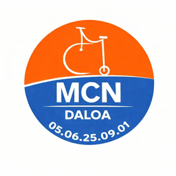
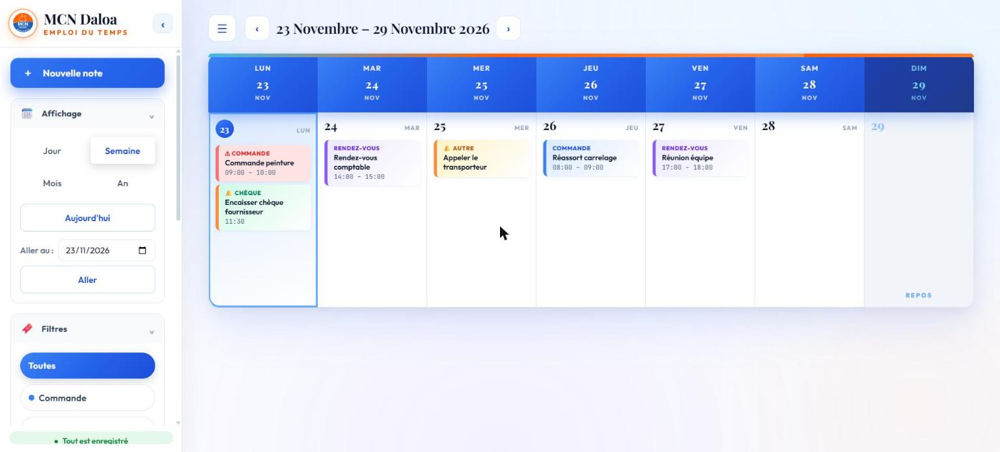
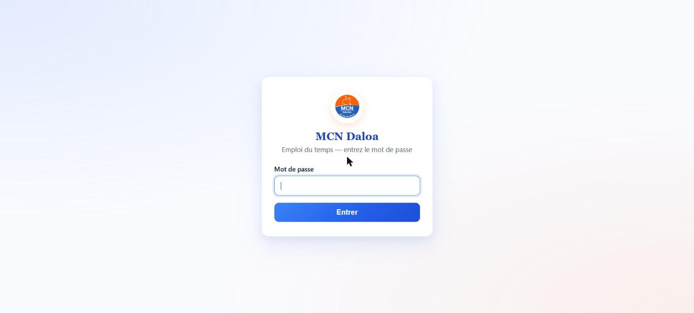
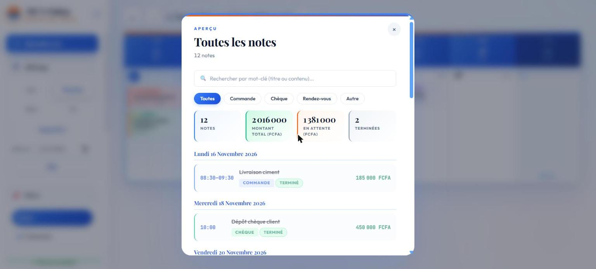
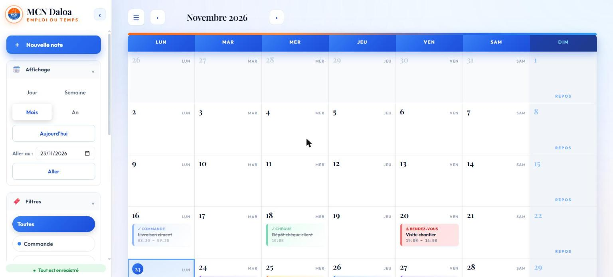

<div align="center">



# MCN Daloa — Emploi du temps

**Un agenda web simple, coloré et protégé par mot de passe pour suivre commandes, chèques, rendez-vous et tâches du quotidien.**

PHP 8 · MySQL / MariaDB · HTML + JavaScript sans framework · aucune dépendance à installer

[](LICENSE)

</div>

---

<p align="center">
  
</p>

## Sommaire

- [Fonctionnalités](#fonctionnalités)
- [Captures d'écran](#captures-décran)
- [Sécurité](#sécurité)
- [Installation sur votre ordinateur (XAMPP)](#installation-sur-votre-ordinateur-xampp)
- [Mise en ligne chez un hébergeur](#mise-en-ligne-chez-un-hébergeur)
- [Configuration](#configuration)
- [Comment ça marche](#comment-ça-marche)
- [Structure du projet](#structure-du-projet)
- [Licence](#licence)

## Fonctionnalités

| | |
|---|---|
| 🗓️ **4 vues de calendrier** | Jour, Semaine, Mois et An, avec navigation et « Aller au » une date précise. |
| 🎨 **4 types de notes** | Commande, Chèque, Rendez-vous et Autre, chacun avec sa couleur et un filtre dédié. |
| 💰 **Montants en FCFA** | Montant par note, et totaux automatiques (total, en attente, terminées) dans la liste des notes. |
| ✅ **Suivi** | Notes « terminées » barrées, notes en retard signalées en rouge. |
| 🔔 **Rappel** | Une note en rappel non terminée avance d'elle-même au jour actuel (le dimanche est un jour de repos). |
| 🔎 **Recherche** | Recherche par mot-clé dans le titre et le contenu, combinable avec les filtres. |
| 🖨️ **Impression & Excel** | Impression propre de la période affichée, export CSV compatible Excel (accents inclus). |
| ☁️ **Enregistrement automatique** | Chaque changement part tout seul vers la base de données, note par note. Indicateur « Tout est enregistré ». |
| 📶 **Hors-ligne** | Si la connexion coupe, les changements sont gardés dans le navigateur et renvoyés automatiquement au retour du réseau. |
| 📱 **Plusieurs appareils** | Téléphone et ordinateur restent synchronisés : la page relit la base toutes les 30 s, sans écraser ce qui a été saisi ailleurs. |
| 🎭 **Thèmes** | Clair, sombre, sépia et gris, plus une couleur de texte personnalisable. |

## Captures d'écran

<table>
  <tr>
    <td width="50%"><br><sub><b>Entrée protégée</b> — un seul mot de passe, demandé à chaque visite.</sub></td>
    <td width="50%"><br><sub><b>Liste des notes</b> — recherche, filtres et totaux en FCFA.</sub></td>
  </tr>
  <tr>
    <td colspan="2"><br><sub><b>Vue mois</b> — notes terminées barrées, retards en rouge, indicateur d'enregistrement en bas à gauche.</sub></td>
  </tr>
</table>

<sub>Les captures montrent des notes d'exemple fictives.</sub>

## Sécurité

L'application est pensée pour **une seule personne** : pas de comptes, **un seul mot de passe**.

- **Mot de passe à chaque visite** : il est redemandé à la fermeture du navigateur ou après 2 heures sans activité. Le bouton 🔒 **Verrouiller** referme tout de suite.
- **Anti-devinette** : après 5 mauvais mots de passe, plus aucun essai n'est accepté pendant 15 minutes.
- **Mot de passe jamais stocké en clair** : seule son empreinte (`password_hash`, bcrypt) est enregistrée sur le serveur.
- **Fermé par défaut** : sans mot de passe configuré, le planning ne s'ouvre que sur l'ordinateur lui-même (`localhost`). Un site mis en ligne sans mot de passe affiche « Site non configuré » au lieu des notes.
- **Fichiers sensibles bloqués** (`.htaccess`) : configuration, script SQL et page interne ne sont jamais servis directement.
- **Base de données** : requêtes préparées PDO (pas d'injection SQL), cookie de session `HttpOnly` + `SameSite=Strict`, en-têtes de sécurité, pages non indexées par les moteurs de recherche.

## Installation sur votre ordinateur (XAMPP)

1. Installez [XAMPP](https://www.apachefriends.org) et démarrez **Apache** et **MySQL**.
2. Copiez le dossier `mcn-planning` dans `C:\xampp\htdocs\`.
3. Ouvrez **http://localhost/mcn-planning/**.

C'est tout : la table est créée automatiquement au premier lancement (la base `mcn_daloa` peut être créée en important `mcn-planning/database.sql` dans phpMyAdmin). En local, aucun mot de passe n'est demandé.

> Ouvrez toujours la page par `http://localhost/...` et non en double-cliquant `index.html` : sans le serveur, la base de données n'est pas jointe.

## Mise en ligne chez un hébergeur

Fonctionne chez tout hébergeur **PHP 7.4+ / MySQL** (testé sur InfinityFree, gratuit).

1. **Créez une base MySQL vide** dans le panneau de l'hébergeur et notez : hôte, nom de la base, utilisateur, mot de passe.
2. **Fabriquez l'empreinte de votre mot de passe d'entrée** (au moins 10 caractères) :
   ```bash
   php -r "echo password_hash('VotreMotDePasse', PASSWORD_DEFAULT);"
   ```
   Sous Windows avec XAMPP : `C:\xampp\php\php.exe -r "..."`.
3. **Copiez `config.local.example.php` en `config.local.php`** et remplissez-le (base + empreinte).
4. **Envoyez le contenu du dossier `mcn-planning/`** dans le dossier public du site (`htdocs`, `public_html`, `www`…), avec `.htaccess` et `config.local.php`.
5. Ouvrez l'adresse du site, entrez le mot de passe : la table se crée toute seule.

Si l'hébergeur ne force pas déjà le HTTPS, activez la redirection prévue en commentaire dans `.htaccess` une fois le certificat SSL installé.

## Configuration

Toute la configuration en ligne tient dans **`config.local.php`** (jamais publié, exclu par `.gitignore`) :

| Clé | Rôle |
|---|---|
| `DB_HOST`, `DB_PORT` | Serveur MySQL de l'hébergeur |
| `DB_NAME`, `DB_USER`, `DB_PASS` | Base et identifiants MySQL |
| `APP_PASSWORD_HASH` | Empreinte du mot de passe d'entrée (voir ci-dessus) |

Il peut aussi être placé **un dossier au-dessus du site**, sous le nom `mcn-config.php` : il est alors hors de portée d'internet. Sans aucun de ces fichiers, les valeurs XAMPP par défaut s'appliquent (`root`, sans mot de passe).

## Comment ça marche

```
Navigateur ──► index.php ──(mot de passe OK)──► index.html (calendrier + JavaScript)
                                                     │
                                                     ▼
                                    api.php ◄──► MySQL (table « notes »)
```

| Appel | Rôle |
|---|---|
| `GET api.php?action=list` | Renvoie toutes les notes. |
| `POST api.php?action=sync` | Enregistre des changements **note par note** : `{ "upsert": [note…], "delete": [id…] }`. |
| `POST api.php?action=save` | Remplace toutes les notes (réinitialisation). |
| `GET api.php?action=ping` | Test de santé. |

Toutes les actions exigent le mot de passe (réponse `401` sinon).

**Enregistrement fiable.** La page compare ses notes au dernier état confirmé par le serveur et n'envoie que la différence. Tant qu'un changement n'est pas confirmé, il reste dans le navigateur (`localStorage`) et repart tout seul : toutes les 10 secondes, au retour du réseau, ou après avoir retapé le mot de passe. Avant de relire la base, la page envoie toujours ses propres changements : rien de ce qui a été saisi n'est écrasé. Les nouvelles notes reçoivent un identifiant aléatoire, pour que deux appareils n'en créent jamais deux avec le même numéro.

## Structure du projet

```
mcn-planning/
├── index.php                  Porte d'entrée : mot de passe, puis le planning
├── index.html                 L'application (calendrier, styles, JavaScript)
├── api.php                    Pont JSON entre la page et MySQL
├── config.php                 Connexion MySQL, session, création de la table
├── config.local.example.php   Modèle de configuration pour la mise en ligne
├── database.sql               Création de la base pour XAMPP (facultatif)
├── .htaccess                  Protection des fichiers, en-têtes de sécurité
├── robots.txt                 Interdit l'indexation
└── logo.png
docs/captures/                 Captures d'écran du README
```

## Licence

Le code est publié sous **licence MIT** (voir [LICENSE](LICENSE)) : vous pouvez l'utiliser, le modifier et le redistribuer librement, y compris pour un usage commercial, à condition de conserver la mention de copyright. Il est fourni « tel quel », sans garantie.

Le nom **« MCN Daloa »** et son **logo** ne font pas partie de cette licence : si vous réutilisez l'application, remplacez-les par les vôtres.

---

<div align="center"><sub>MCN Daloa · Daloa, Côte d'Ivoire</sub></div>
